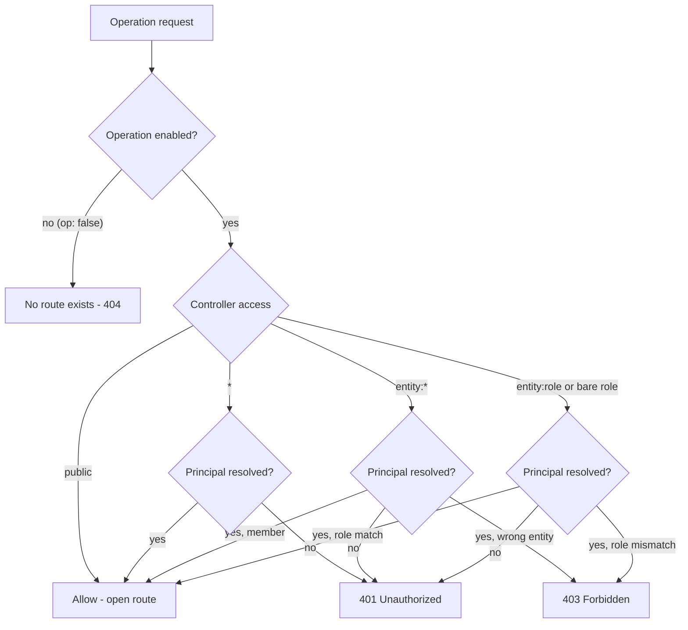

Once your spec contains any `type: auth` entity, the generated app protects every
route by default. You opt a route out of protection only by giving it the literal
`access: public`. There is no implicit "open unless stated" mode; the burden is on
you to mark routes public, not to mark them protected.

## The rule

Every route not declared `access: public` requires a principal that satisfies its
access value. A request without valid credentials gets 401, and an authenticated
request the access value does not admit gets 403. A spec with no `type: auth`
entity has no way to authenticate, so its non-public routes answer every request
with 401: give such routes `access: public`, or add an auth entity.

```yaml
version: "0.2"

api:
  basePath: /api
  version: v1

entities:
  myEntity:
    type: auth
    auth:
      identifier: email
      via: password
    fields:
      id: { type: id }
      email: { type: string, required: true, unique: true }

  myCollection:
    fields:
      id: { type: id }
      title: { type: string, required: true }
```

The repository, service and controller of `myCollection` are left out above; once
its controller sets `access: "*"`, `GET /api/v1/my-collection` returns 401 unless
the caller presents valid credentials.

## Effective access resolution



`stackform run` and every generated backend (FastAPI, DRF, raw ASGI) follow this
same resolution. A request with no credentials on a protected route stops at the "401
if no principal" node; an authenticated request that does not satisfy the role or
`<entity>:*` scope gets 403.

## Access vocabulary

The `access:` value on a controller (or per operation) is drawn from this
vocabulary:

| Value | Meaning |
|-------|---------|
| `public` | No authentication. The only way to opt a route out of protection. |
| `"*"` | Any valid principal from any auth entity. |
| `<entity>:*` | Any principal whose identity collection is `<entity>` -- any member of that auth entity. |
| `<entity>:<role>` | A principal of `<entity>` holding `<role>`, directly or through the role hierarchy. |
| `<role>` | Bare role; allowed only when a single auth entity exists (otherwise `ACCESS_AMBIGUOUS_ROLE`). |

Roles come from the entity-level `roles:` block (managed roles) or from the enum
field named by `auth.roles`. See [Roles overview](../roles/overview.md).

## Controllers without `access:`

A controller that declares no `access:` defaults to `access: public`, so every
route it generates is open. This is the most common way a route is left open by
accident.

```yaml
controllers:
  myCollection:
    service: myCollection        # no access -> every route is public
    base_path: /my-collection
```

Declare the access explicitly to protect it:

```yaml
controllers:
  myCollection:
    service: myCollection
    base_path: /my-collection
    access: "*"
```

Individual operations tighten or loosen the controller default:

```yaml
controllers:
  myCollection:
    service: myCollection
    base_path: /my-collection
    access: "*"
    operations:
      list: { access: public }      # reads open, writes protected
      delete: { access: myEntity:admin }
```

> **Enforcement**
>
> Roles, role hierarchies, `<entity>:*` scoping, and ownership/ABAC `when` rules
> are enforced by the generated FastAPI backend, the generated DRF backend, and the
> `stackform run` dev server alike. A request that no rule admits gets 401 when it
> carries no valid credentials and 403 otherwise; a missing record answers 404
> before ownership is checked.

## See Also

- [Auth overview](./overview.md)
- [Login, SSO, and the token flow](./login-and-sso.md)
- [Access control](../controllers/access-control.md)
- [Controllers overview](../controllers/overview.md)
- [Roles overview](../roles/overview.md)
